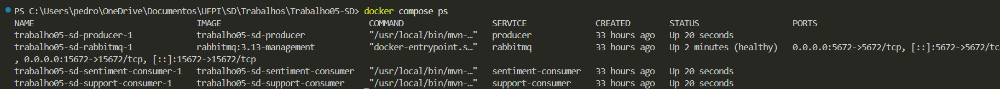
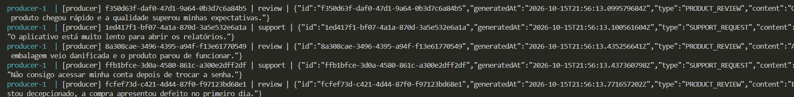
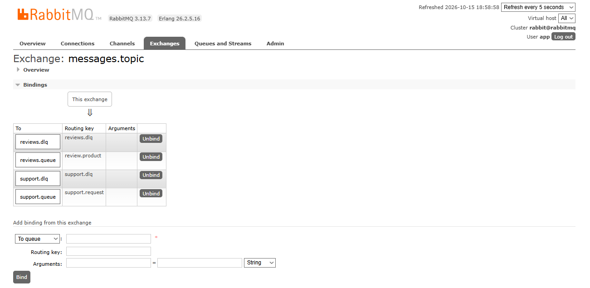
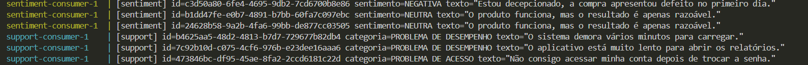
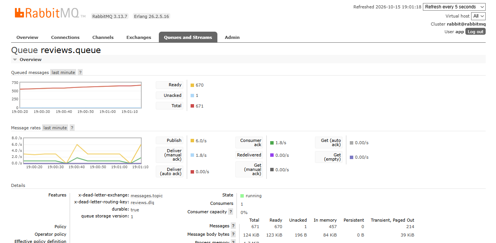
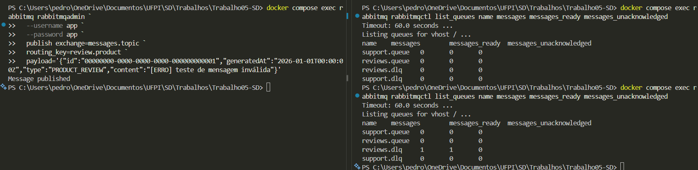
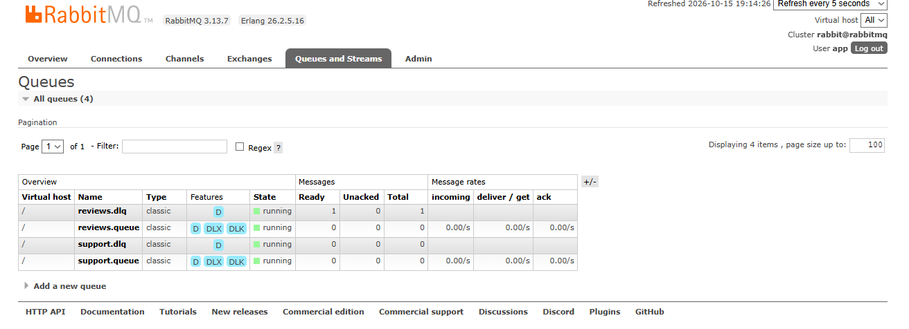

# Trabalho 05 - Sistema Distribuído de Classificação de Mensagens

Sistema distribuído de geração e classificação de mensagens que utiliza **Java**, **Docker**, **RabbitMQ** e **Smile**. O produtor publica avaliações de produtos e solicitações de suporte em um **Topic Exchange**, enquanto dois consumidores independentes classificam as mensagens usando IAs baseadas em **KNN**. Projeto acadêmico da disciplina de Sistemas Distribuídos.

    

## Sumário

- [Como rodar](#como-rodar)
  - [Pré-requisitos](#pré-requisitos)
  - [Iniciar o sistema](#iniciar-o-sistema)
  - [Acompanhar os logs](#acompanhar-os-logs)
  - [Acessar o RabbitMQ](#acessar-o-rabbitmq)
  - [Testar a Dead Letter Queue](#testar-a-dead-letter-queue)
- [Estrutura do projeto](#estrutura-do-projeto)
- [Arquitetura](#arquitetura)
- [Descrição das IAs](#descrição-das-ias)
  - [IA de análise de sentimento](#ia-de-análise-de-sentimento)
  - [IA de classificação de suporte](#ia-de-classificação-de-suporte)
- [Evidências de execução](#evidências-de-execução)
  - [Containers em execução](#1-containers-em-execução)
  - [Geração contínua de mensagens](#2-geração-contínua-de-mensagens)
  - [Encaminhamento pelo Topic Exchange](#3-encaminhamento-pelo-topic-exchange)
  - [Classificação pelas duas IAs](#4-classificação-pelas-duas-ias)
  - [Crescimento das filas](#5-crescimento-das-filas)
  - [Tratamento de erro pela DLQ](#6-tratamento-de-erro-pela-dlq)
  - [Link do vídeo](#link-do-vídeo)

## Como rodar

### Pré-requisitos

- Docker Desktop instalado e com o Docker Engine em execução;
- Docker Compose v2.

Java 17 e Maven 3.9 são necessários somente para compilação local. A execução recomendada ocorre inteiramente nos containers.

### Iniciar o sistema

No PowerShell, entre na raiz do projeto:

```powershell
cd "C:\Users\pedro\OneDrive\Documentos\UFPI\SD\Trabalhos\Trabalho05-SD"
```

Construa as imagens e inicie os quatro containers:

```powershell
docker compose up -d --build
```

Verifique o estado dos containers:

```powershell
docker compose ps
```

Os serviços esperados são:

```text
rabbitmq
producer
sentiment-consumer
support-consumer
```

### Acompanhar os logs

Logs somente do produtor:

```powershell
docker compose logs -f producer
```

Logs dos dois consumidores:

```powershell
docker compose logs -f sentiment-consumer support-consumer
```

Logs somente do consumidor de sentimento:

```powershell
docker compose logs -f sentiment-consumer
```

Logs somente do consumidor de suporte:

```powershell
docker compose logs -f support-consumer
```

### Acessar o RabbitMQ

Abra <http://localhost:15672> no navegador.

```text
Usuário: app
Senha: app
```

No painel, acesse **Queues and Streams** para observar:

- `reviews.queue`;
- `support.queue`;
- `reviews.dlq`;
- `support.dlq`.

Para encerrar os containers:

```powershell
docker compose down
```

Para remover também os volumes e as mensagens persistidas:

```powershell
docker compose down -v
```

### Testar a Dead Letter Queue

Com o sistema em execução, publique uma mensagem inválida:

```powershell
docker compose exec rabbitmq rabbitmqadmin `
  --username app `
  --password app `
  publish exchange=messages.topic `
  routing_key=review.product `
  payload='{"id":"00000000-0000-0000-0000-000000000001","generatedAt":"2026-01-01T00:00:00Z","type":"PRODUCT_REVIEW","content":"[ERRO] teste de mensagem inválida"}'
```

O consumidor de sentimento rejeitará a mensagem sem requeue. Ela deverá aparecer em `reviews.dlq`.

Para consultar as filas pelo terminal:

```powershell
docker compose exec rabbitmq rabbitmqctl list_queues name messages messages_ready messages_unacknowledged
```

## Estrutura do projeto

```text
Trabalho05-SD/     
├── app/         
│   ├── common/                     
│   │   ├── pom.xml
│   │   └── src/main/java/br/edu/ufpi/sd/common/
│   │       ├── Message.java
│   │       ├── MessageCodec.java
│   │       ├── MessageType.java
│   │       ├── MessagingConfig.java
│   │       ├── QueueTopology.java
│   │       └── RabbitConnection.java
│   ├── producer/
│   │   └── src/main/java/br/edu/ufpi/sd/producer/
│   │       └── MessageProducer.java
│   ├── sentiment-consumer/
│   │   └── src/main/java/br/edu/ufpi/sd/sentiment/
│   │       ├── SentimentClassifier.java
│   │       └── SentimentConsumer.java
│   └── support-consumer/
│       └── src/main/java/br/edu/ufpi/sd/support/
│           ├── SupportClassifier.java
│           └── SupportConsumer.java
├── docker/
│   ├── producer.Dockerfile
│   ├── sentiment.Dockerfile
│   └── support.Dockerfile
├── .github/
│   └── screenshots/
├── docker-compose.yml
├── pom.xml
└── README.md
```

Responsabilidades principais:

- `app/common`: contratos das mensagens, conexão com RabbitMQ, codec JSON e
  declaração da topologia;
- `app/producer`: geração e publicação das mensagens;
- `app/sentiment-consumer`: consumo e análise de sentimento;
- `app/support-consumer`: consumo e classificação das solicitações;
- `docker`: imagens dos três serviços Java;
- `docker-compose.yml`: orquestração dos quatro containers.

## Arquitetura

O sistema possui quatro containers conectados pela mesma rede Docker:

```text
┌──────────────┐       review.product       ┌─────────────────┐
│   producer   │ ─────────────────────────> │  reviews.queue  │
└──────┬───────┘                            └────────┬────────┘
       │                                             │
       │                                             v
       │                                    ┌────────────────────┐
       │                                    │ sentiment-consumer │
       │                                    └─────────┬──────────┘
       │                                              │
       │                         erro                 v
       │                                    ┌─────────────────┐
       │                                    │   reviews.dlq   │
       │                                    └─────────────────┘
       │
       │       support.request              ┌─────────────────┐
       └──────────────────────────────────> │  support.queue  │
                                            └────────┬────────┘
                                                     │
                                                     v
                                            ┌─────────────────┐
                                            │ support-consumer│
                                            └────────┬────────┘
                                                     │
                                      erro           v
                                            ┌─────────────────┐
                                            │   support.dlq   │
                                            └─────────────────┘
```

O produtor publica no exchange:

```text
messages.topic
```

Esse exchange é do tipo **Topic** e utiliza as routing keys:

```text
review.product
support.request
```

O RabbitMQ encaminha cada mensagem para a fila correspondente. As filas usam confirmação manual. Após o processamento bem-sucedido, o consumidor chama `basicAck`. Em caso de erro, chama `basicNack` sem requeue, fazendo com que a mensagem seja enviada para a respectiva DLQ.

O produtor gera aproximadamente seis mensagens por segundo: três avaliações de produtos e três solicitações de suporte. Os consumidores processam as mensagens mais lentamente para permitir a visualização do crescimento das filas.

## Descrição das IAs

O projeto utiliza a biblioteca **Smile**, versão `3.1.1`, com o algoritmo **K-Nearest Neighbors (KNN)**. São dois classificadores independentes, um em cada consumidor.

### IA de análise de sentimento

Implementada em `app/sentiment-consumer`.

O classificador transforma o texto em um vetor de características baseado na presença de palavras relevantes e compara esse vetor com exemplos locais rotulados. O resultado pertence a uma das classes:

- `POSITIVA`;
- `NEGATIVA`;
- `NEUTRA`.

Exemplo:

```text
O produto chegou rápido e a qualidade superou minhas expectativas.
Resultado: POSITIVA
```

### IA de classificação de suporte

Implementada em `app/support-consumer`.

Esse classificador utiliza outro conjunto de exemplos e outro conjunto de características. O resultado pertence a uma das classes:

- `PROBLEMA DE ACESSO`;
- `PROBLEMA DE DESEMPENHO`;
- `PROBLEMA DE CONEXÃO`.

Exemplo:

```text
O aplicativo está muito lento para abrir os relatórios.
Resultado: PROBLEMA DE DESEMPENHO
```

As IAs são embarcadas nos consumidores e não dependem de APIs externas. Elas foram desenvolvidas como modelos didáticos de classificação supervisionada, utilizando exemplos de treinamento definidos localmente.

## Evidências de execução

Esta seção contém as capturas realizadas durante a demonstração. As imagens estão salvas em `.github/screenshots/` e referenciadas nos espaços abaixo.

### 1. Containers em execução

Capturado o resultado de:

```powershell
docker compose ps
```

Essa captura mostra os quatro containers ativos:

- RabbitMQ;
- produtor;
- consumidor de sentimento;
- consumidor de suporte.

**Captura do terminal:**

<!-- Insira aqui a captura do comando docker compose ps. -->



### 2. Geração contínua de mensagens

É capturado os logs do produtor através do comando:

```powershell
docker compose logs -f producer
```

Os logs mostram mensagens com IDs, horários, tipos e conteúdos diferentes.

**Captura do terminal:**

<!-- Insira aqui a captura dos logs do produtor. -->



### 3. Encaminhamento pelo Topic Exchange

No painel do RabbitMQ, em **Exchanges** e `messages.topic`, são exibidos os bindings:

```text
review.product  -> reviews.queue
support.request -> support.queue
```

**Captura da interface do RabbitMQ:**

<!-- Insira aqui a captura do exchange e dos bindings. -->



### 4. Classificação pelas duas IAs

É capturado os logs dos consumidores através do comando:

```powershell
docker compose logs -f sentiment-consumer support-consumer
```

Aparece os resultados de sentimento e de classificação de suporte, por exemplo:

```text
[sentiment] ... sentimento=POSITIVA ...
[support] ... categoria=PROBLEMA DE CONEXÃO ...
```

**Captura do terminal:**

<!-- Insira aqui a captura dos logs dos consumidores. -->



### 5. Crescimento das filas

No painel do RabbitMQ, em **Queues and Streams** é capturada as filas `reviews.queue` e `support.queue` em dois momentos diferentes.

Observe principalmente:

- `Ready`: mensagens aguardando processamento;
- `Unacked`: mensagens entregues e ainda não confirmadas;
- `Messages`: total de mensagens na fila.

**Captura inicial da interface do RabbitMQ:**

<!-- Insira aqui a primeira captura das filas. -->



**Captura posterior da interface do RabbitMQ:**

<!-- Insira aqui a segunda captura das filas. -->


### 6. Tratamento de erro pela DLQ

Publicada a mensagem inválida conforme instruído na seção **Como rodar**. É registrado:

1. o log do consumidor informando o erro e o encaminhamento para a DLQ;
2. a fila `reviews.dlq` no painel do RabbitMQ contendo a mensagem;
3. opcionalmente, a consulta das filas pelo terminal.

**Captura do terminal:**

<!-- Insira aqui a captura do erro e do basicNack. -->



**Captura da interface do RabbitMQ:**

<!-- Insira aqui a captura da reviews.dlq. -->



### Link do vídeo

[clique aqui para assistir o vídeo no youtube](https://youtu.be/aWMPGsDxqOY)

### Licença

Este projeto está disponibilizado sob a licença [CC0 1.0 Universal](./LICENSE).

Projeto acadêmico da disciplina de Sistemas Distribuídos — UFPI.